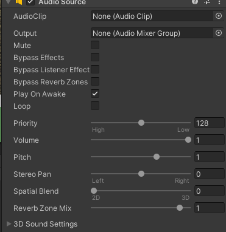
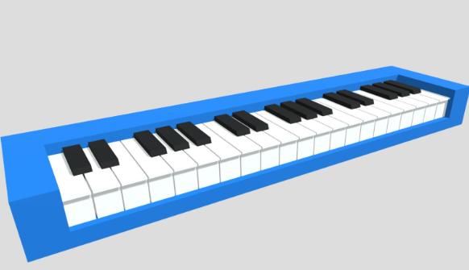

**Лабораторная работа №4**

Тема: Звук
Цель: Научиться работать со звуком в Unity

Рассчитано на кол-во пар: 1

___

#### Теоретическая часть

Звук – это неотъемлемая часть любой игры. Для его внедрения в Unity мы будем использовать компонент **Audio Source**



Данный компонент можно добавить на любой из объектов, либо создать заготовку (пустой источник звука) с помощью ПКМ в Hierarchy -> Audio -> Audio Source

Основными настройками компонента являются *AudioClip* – непосредственно сам звук и *Volume* – громкость издаваемого звука.

#### Практическая часть
##### Сделаем воспроизведение звука при нажатии клавиши.

1. Для начала создадим 3D-куб
2. Добавим на него компонент AudioSource
3. Скачаем любой звук из [папки файлов](../00_Ресурсы/01_Файлы/)
4. Создадим внутри проекта папку `Sounds/`
5. Переносим файл звука внутрь папки
6. Создадим новый скрипт `SoundCube.cs` и напишем следующий код:

```cs
public class SoundCube : MonoBehaviour
{
    AudioSource source;

    // Здесь будем указывать звук, который будем проигрывать
    public AudioClip clip;

    void Start()
    {
        source = GetComponent<AudioSource>();
    }

    void Update()
    {
        if (Input.GetKeyDown(KeyCode.G))
        {
            source.PlayOneShot(clip);
        }
    }
}

```

Мы можем заметить, что для воспроизведения звука используется функция `PlayOneShot(AudioClip clip)`. Эта функция воспроизводит заданный клип один раз.

> Если ваша ситуация не подразумевает наличия разных клипов, то указать клип можно прямо в настройках компонента AudioSource, однако учтите, что по умолчанию включена функция `Play On Awake`, воспроизводящая звук при старте. В таком случае используется функция `AudioSource.Play()`
> 

Запустив игру и нажав на `G` вы услышите выбранный вами звук!

#### Самостоятельное задание

Сделайте простую модель синтезатора или пианино в Blender'е и найдите 3-4 звука для нее.
Пусть при нажатии разных клавиш воспроизводится разный звук



##### Дополнительно по желанию

Реализовать движение клавиш пианино в момент нажатия кнопки клавиатуры. Клавиши должны опускаться, издавая звук.
___

Критерии оценки

1. Сделана практическая часть – 4
2. Сделана самостоятельная работа – 5