Представим у вас есть готовая модель в Blender

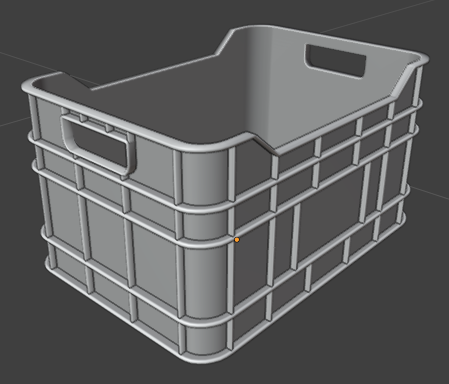

Перед тем как ее экспортировать вам нужно проверить несколько ключевых моментов.

#### Применение трансформации объекта
Если открыв вкладку Object, вы видите следующие значения Rotation и Scale, отличимые от:
Rotation 0 0 0, Scale 1 1 1, то это может плохо сказать на экспорте вашей модели.

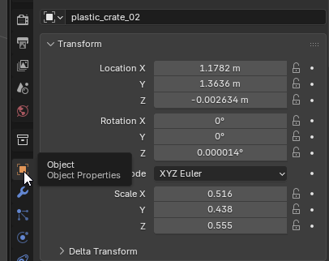

Для того, чтобы исправить это. Вам достаточно выделить модель и нажать Ctrl + A:

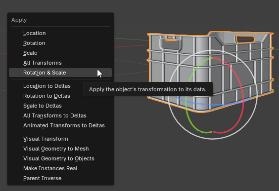

И выбрать пункт Rotation & Scale. Теперь вы заметите, что значения этих параметров поменялись:

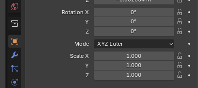

В ином случае ваша модель бы воспринималась движком, как искаженная. Это могло вызвать неожиданное поведение.

#### Origin

Origin – это осевая точка вашей модели. Относительно нее происходит перемещение и вращение объекта. Зачастую – это центр вашего объекта. Origin выглядит как оранжевая точка:

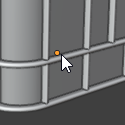

Но что если она находится где-то в другом месте? Или что если вы делаете, условно, дверь, вращение которой должно происходить относительно петель, а не центра полотна.

1. **Origin не в том месте**
   
   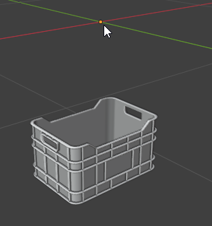
   
   Для того чтобы решить следующую проблему вам достаточно нажать по объекту ПКМ (правой кнопкой мыши) и выбрать поле Set Origin -> Origin To Geometry (Origin к геометрии)
   
   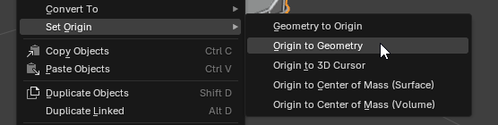
   
   После этого ваша осевая точка расположится по центру объекта
2. **Origin нужно сместить**
   Для решения это проблемы мы будем использовать 3D Cursor – точку в 3D пространстве.
   
   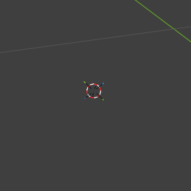
   
   Вот он.
   Чтобы поставить его туда, куда нам нужно у нас есть два способа. Разберем самый точный.
   
   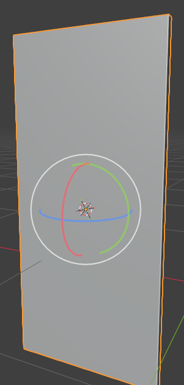
   
   Вот наша дверь. Мы хотим сместить Origin влево. Для этого: заходим в Edit Mode -> Выделяем нужную грань
   
   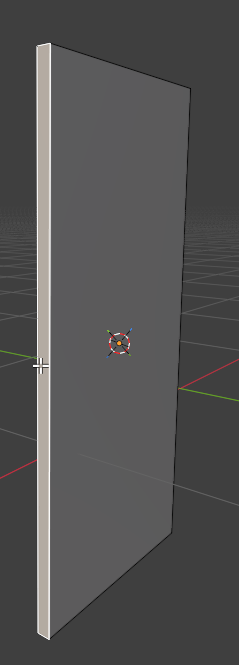
   
   Вызываем меню управления курсором по нажатию Shift + S и выбираем Cursor to Selected (3D Курсор к выбранному)
   
   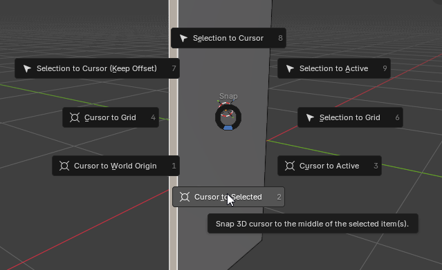
   
   Теперь наш 3D курсор находится по центру выделенной грани. Там где мы хотим расположить Origin. Остается его переместить. Для этого: выходим из Edit Mode -> Нажимаем ПКМ по объекту -> Set Origin -> Origin to 3D Cursor
   
   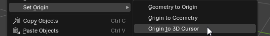

   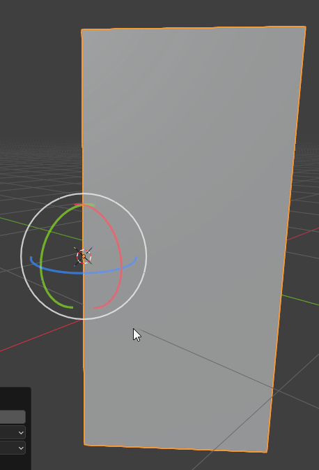

   Успех!