# Введение

Представим, что вы сделали высокополигональную крутую модель, к примеру кресла!

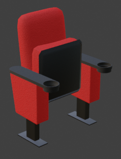

Узнать количество полигнов мы можем включив статистику:

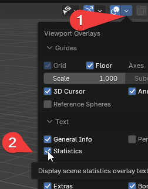

Теперь взглянем на верхний левый угол и увидим поле Triangles (Треугольники) – это и есть наши полигоны

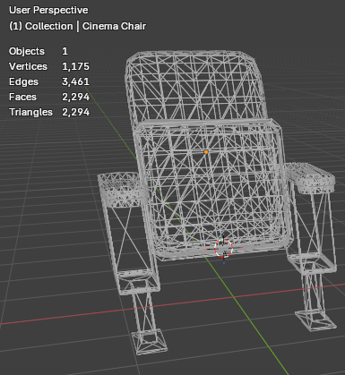

## Категория модели в зависимости от кол-ва полигонов

| Категория                             | Примерное кол-во полигонов (Tris) | Где применяется                                                        |
| ------------------------------------- | --------------------------------- | ---------------------------------------------------------------------- |
| **Low-poly (Игровой / Game-ready)**   | 50 – 15 000                       | Мобильные 3D-игры, XR, второстепенные персонажи и оружие в ПК-играх.   |
| **Mid-poly**                          | 15 000 – 100 000                  | Главные герои, транспорт и оружие от первого лица в современных играх. |
| **High-poly (Игровой / кино)**        | 100 000 – 1 000 000+              | Ассеты для движков нового поколения, рендеры для рекламы.              |
| **High-poly (Скульптинг / Исходник)** | 1 000 000 – 50 000 000+           | Цифровая лепка, визуальные эффекты в кино (VFX), 3D-печать.            |

И так, ваше кресло подпадает под понятие Low-Poly, Однако!
Что если в вашей локации подразумевается использование 30ти или 50ти таких объектов? В сумме это будет свыше 200 тысяч полигонов в одном месте.

> Возможно современные компьютеры даже не заметят этого, но мы рассматриваем лишь небольшой пример

# Решение

Для решения следующей проблемы с огромным количеством полигонов мы будем использовать метод LOD'ов.

> **LOD**  – Level of Detail или же "Уровень детализации"

Логика в том, что мы будем делать несколько уровней детализации одной модели. Выглядеть это будет следующим образом:

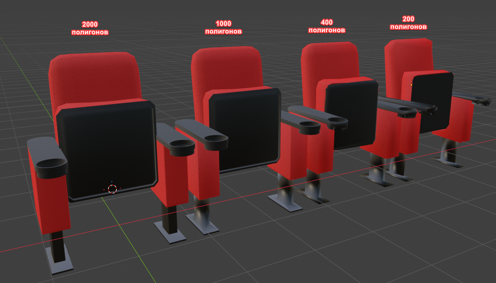

Визуально разница практически незаметна, однако число полигонов уменьшается в десятки раз!

> **Важный момент!** LOD'ы зачастую применяются при отдалении от объекта. То есть, объект уменьшает количество своих полигонов в зависимости от того, как далеко он находится. На расстоянии разница еще менее заметна

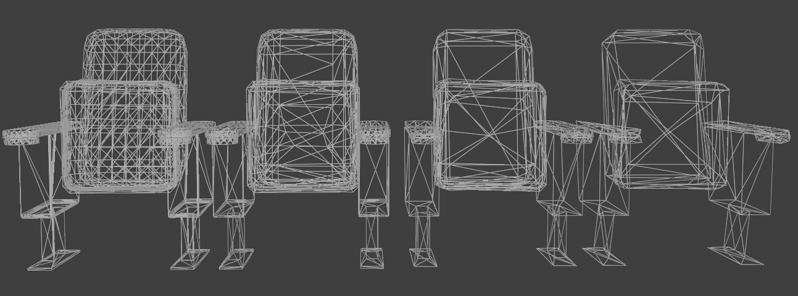

На отображении Wireframe изменение полигональной сетки заметно сильнее.

# Применение

> Для создания из модели LOD'ов мы можем использовать модификатор **Decimate**

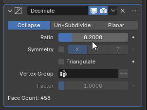

### Действия по шагам:
1. Создадим несколько копий одного объекта. Обычно 2-3:
   
   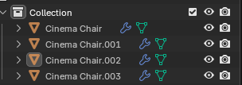
   
2. Подпишем их по уровню LOD:
   
   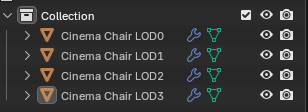
   
   LOD0 – Это изначальная модель. LOD3 – Максимально ужатая
3. Выберем LOD1, добавим на него модификатор Decimate и установим Ratio = 0.5
   Ratio – это степень того, насколько сильно ужмется объект
4. Повторим все эти действия с оставшимися моделями.
5. **Важно!** Разместите все объекты друг в друге!
6. Создайте пустой объект:
   
   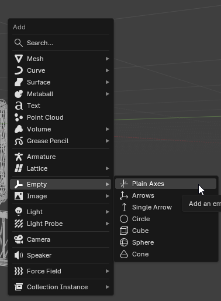
   
7. Выделите все модели LOD, а затем выделите Empty. Так, чтобы Empty стал Active:
   
   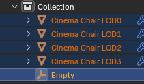
   
8. ПКМ -> Parent -> Object
   
   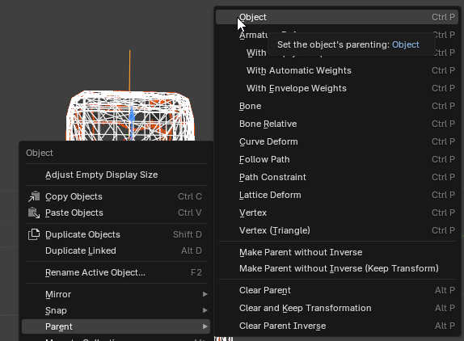
9. Переименуем Empty в более адекватное название.
10. Экспортируем пустой объект в Unity.
11. Импортировав модель в Unity, заметим что добавились и все LOD'ы:
    
    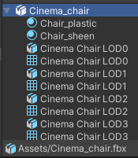
12. Отлично! Теперь разместим наш объект на сцене и добавим на него компонент **LOD Group**
    
    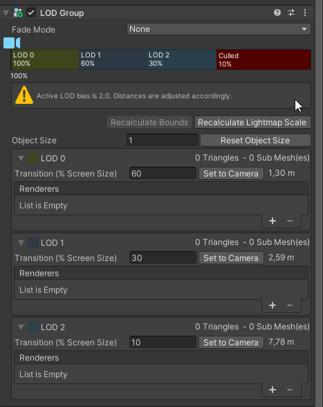
    
    Под каждый LOD выбираем соответствующую модель из списка.
    Если нам не хватило LOD'ов, нажимаем ПКМ на **Culled** и выбираем **Insert Before**
    
    > Culled – это граница за которой объект вообще удаляется из поля зрения
    
    
    
    Здесь же мы можем редактировать отдаление камеры, при котором будет отображаться тот или иной LOD, либо устанавливать эту границу в зависимости от текущего расположения камеры
    
    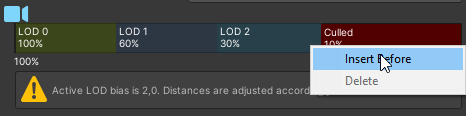

# Итог

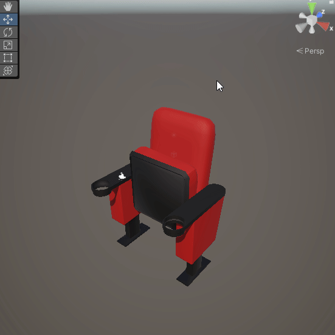

В итоге у нас должно получиться такое постепенное изменение количества полигонов в зависимости от отдаления от камеры.

