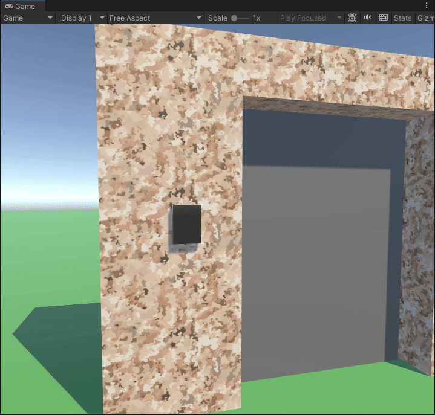
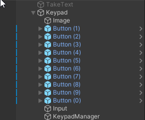
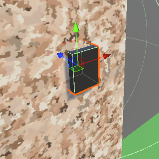
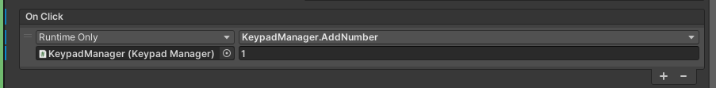
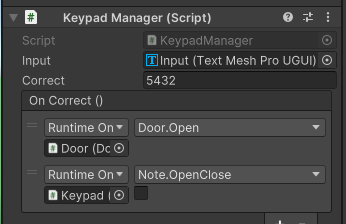

По аналогии с [Созданием записок](./03_Создание_записок.md) мы можем реализовать систему кодового замка



Это максимально простой путь реализации данной механики.

Начнем со структуры сцены:
- Игрок
- Canvas \[UI -> Canvas]
  Холст для расположения UI Объектов
	- TakeText \[UI -> TextMeshPro]
	  Текст с подсказкой – как взять записку
	- Keypad \[Empty]
	  Родительский объект замка для других UI элементов.
		- Button \[UI -> Button]
		  Каждая кнопка (например от 1 до 9)
		- Input \[UI -> Text]
		  Текстовое поле на котором будет отображаться код
		- KeypadManager \[Empty]
		  Объект, отвечающий за логику происходящего
- Keypad \[3D -> Cube]
  Физический объект замка. Куб, например





Для объекта Keypad используется аналогичный скрипт записки из "[Создание записок]"

А вот код KeypadManager

```c#
public class KeypadManager : MonoBehaviour
{
	// Текстовое поле где будет писаться код
    public TMP_Text input;
    // Верный код. Можно задать в инспекторе
    public string correct = "0000";
    // Событие "Код введен верно"
    public UnityEvent OnCorrect;

    public void AddNumber(string number)
    {
	    // Добавляем нажатую клавишу в вывод
        input.text += number;

		// Если код корректен, вызываем событие
        if (input.text == correct)
        {
            OnCorrect.Invoke();
        }
		
		// Если код превышает лимит, то сбрасываем его
        if (input.text.Length >= correct.Length)
        {
            input.text = "";
        }
    }
}
```

В каждом OnClick добавляем ссылку на KeypadManager и вызов метода `AddNumber`. Вот пример для цифры `1`:



Результат:



С помощью UnityEvent может подключить выполнение любого кода, по аналогии с VR и OnClick