# Практика УП15.01 Программирование игр
## Цель: разработка 3D-игры
## Средства разработки: Unity, Blender, Substance Painter

# Структура практики

| № Этапа | День   | Дата          | Задачи                                                                            | Критерии выполнения                                                              |
| ------- | ------ | ------------- | --------------------------------------------------------------------------------- | -------------------------------------------------------------------------------- |
| 1       | 1 - 2  | 09.11 - 10.11 | 1. Формирование команды 2. Разработка идеи и сценария игры                     | 1. Соблюдение всех [требований](01_Шаблон_1_этапа.md) 2. Согласованность с преподавателем             |
| 2       | 2 - 5  | 10.11 - 13.11 | 1. Моделирование основных игровых моделей 2. Текстурирование созданных моделей | 1. Модели визуально подходят под описание 2. Согласованность с преподавателем |
| 3       | 6 - 7  | 14.11 - 16.11 | 1. Создание игровых локаций с использованием созданных моделей                    | 1. Локации подходят по сюжеты игры 2. Согласованность с преподавателем        |
| 4       | 8 - 14 | 17.11 - 21.11 | 1. Программирование игры 2. Презентация готового продукта                      |                                                                                  |
___
# 1 Этап
## Формирование команды
Требования:
- Минимальное кол-во участников – 2
- Максимальное кол-во участников – 3

Распределение ролей внутри команды *не регламентировано*, однако советуется следующая структура:
- **Моделлер**. Человек, отвечающий за создание моделей и локаций;
- **Разработчик**. Человек, отвечающий за написание игрового кода;
- Доп: **Менеджер**. Человек, воплощающий в себе две предыдущие роли. Помогает решать конфликты и искать пути решения.

По окончанию каждого дня преподавателем будет осуществляться опрос каждой команды на наличие результата, а так же оценка вклада каждого из участников процесса.

## Разработка идеи и сценария игры
### Выбор идеи
Идея должна быть простой и незамысловатой. Не пытайтесь сразу создать шедевр, пусть это будет что-то простое и банальное. Лучше сделать хоть что-то простое, чем замахнуться на реализацию чего-то сложного и не сделать ничего. 

Идеи, описанные в материалах для подготовки к практике – использовать **ЗАПРЕЩЕНО**, однако на них **МОЖНО** и **НУЖНО** опираться, как на пищу для размышления.

В процессе размышления разрешается спрашивать мнения и искать вдохновения у одногруппников, преподавателя и даже ИИ (в разумных рамках).

Идея игры обязательно должна быть обговорена с преподавателем.

### Разработка сюжета
Сюжет вашей игры – это не трехтомный труд, описывающий все и каждое. В вашем случае, **сюжет** – это цепочка действий, которые нужно выполнить игроку, чтобы перейти из точки А (начало игры) в точку Б (конец игры).

Лучше всего для описания сюжета подойдет текстовое описание + блок-схема, например:

1. Вы появляетесь в приемной своего кабинета и видите, что вокруг темно. Вы ничего не помните, свет отключен а парадная дверь заперта. Вы решаетесь восстановить питание, пройдя на склад и активировав генератор. Действие должно сопровождаться соблюдением условия – заправкой генератора
2. Вы находите на складе канистру бензина и генератор. Заливаете бензин в генератор и запускаете аварийное электропитание. В свете ламп вы видите заметку у шахты лифта "Код от сейфа – AGUQ на машинке". Этот текст писали вы, но ничего о нем не помните.
3. На вашем рабочем столе находится печатная машинка, но одна из кнопок утеряна. Это кнопка "Q". Через время вы находите её копошась в ящиках. Вставив клавишу на место, вы набираете на ней "AGUQ" и на листке вдруг появляются цифры "8190".
4. Порыскав в кабинете ещё какое-то время, за картиной вы находите сейф встроенный в стену. Набрав код "8190", он открывается и там лежит связка ключей. Один из ключей подходит к скважине замка шахты лифта.
5. Вы открываете лифт, нажимаете первый этаж и игра пройдена.
