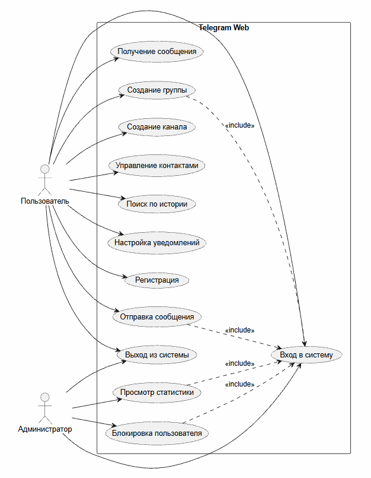
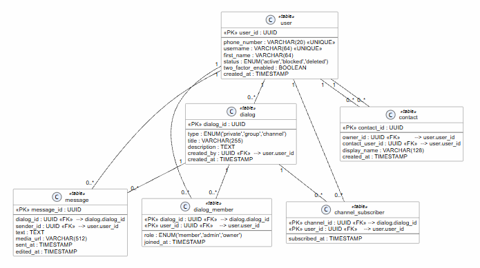

# Пример выполнения работы на примере Telegram

## Титульный лист

**Выполнил(а):** Дуров Павел*
**Группа**: ИИ-334

\* Павел Дуров включен Росфинмониторингом в перечень организаций и физических лиц, в отношении которых имеются сведения об их причастности к экстремистской деятельности или терроризму.

---

## 1. Номер варианта и краткое описание предметной области

**Вариант:** Мессенджер Telegram.

**Предметная область:** обмен мгновенными сообщениями в личных и групповых чатах, публичные каналы, управление контактами, поиск по истории, настройка уведомлений.

---

## 1.1. Ключевые сущности

1. **Пользователь** — учётная запись (id, телефон, username, имя, статус).
2. **Чат** — личный диалог или группа (id, тип, название, дата создания).
3. **Сообщение** — единица контента (id, текст, медиа, дата, отправитель, чат).
4. **Контакт** — запись в адресной книге (id, владелец, контакт, отображаемое имя).
5. **Канал** — публичный ресурс (id, название, описание, число подписчиков).

---

## 2. Техническое задание

Заказчик — команда Telegram. Система представляет собой мессенджер для обмена мгновенными сообщениями. Система должна обеспечивать регистрацию и вход пользователей, личные и групповые чаты, публичные каналы, отправку текста, файлов и изображений, управление контактами, поиск по истории и настройку уведомлений. Дополнительно требуется администрирование: статистика, жалобы и блокировка пользователей.

Ключевые ограничения: шифрование трафика, кроссплатформенность, высокая доступность и масштабируемость.

---

## 2.1. Выбор модели жизненного цикла

**Выбрана итерационная модель ЖЦ.**

**Аргументация:** Telegram активно развивается, требования меняются часто, новые функции выпускаются регулярно. Итерационная модель позволяет выпускать работающие версии каждые 2–4 недели, собирать обратную связь и корректировать бэклог. Каскадная модель не подходит из‑за фиксированных требований и низкой гибкости.

---

## 3. Use-Case диаграмма

## 4. ER-диаграмма

