#### Главное действующее лицо

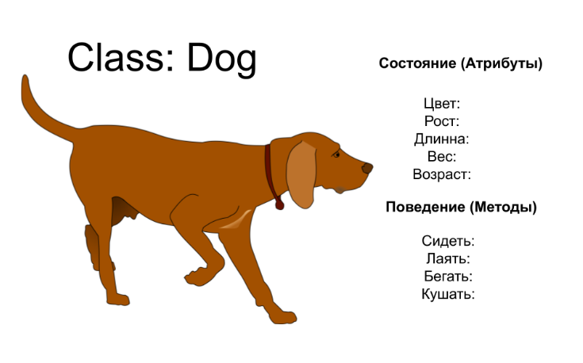

Для начала напомним себе что такое класс? Если в двух словах, то класс представляет собой шаблон для создания объектов, обеспечивающий начальные значения состояний: инициализацию полей-переменных и реализацию поведения полей и методов.

По сути, класс описывает то, каким объект может быть.

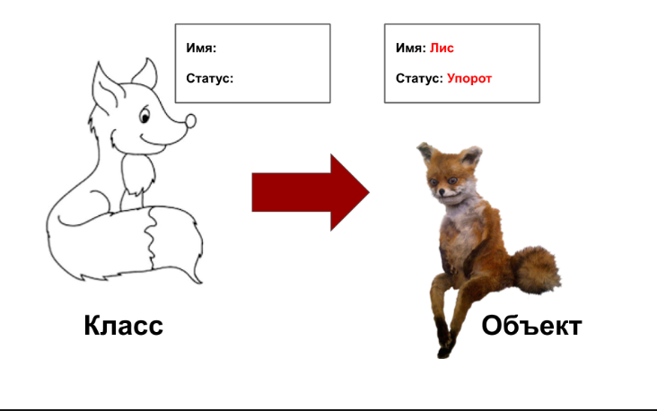

Класс представляет концепт, который описывает состояние (атрибуты) и поведение (методы). Каждый атрибут имеет свой тип, каждый метод — свою сигнатуру, но в диаграмме классов только имя класса является обязательной информацией к заполнению, что и логично — даже лучшие экстрасенсы мира не смогут понять, что это за безымянный квадрат и к чему он вообще относится.  
  
Имя класса пишется в самом верхнем делении, затем идут атрибуты класса, типы которых записываются после двоеточия и, наконец, в нижнем делении идут методы.  
  
Тип, который может возвращать метод, записывается после двоеточия в самом конце сигнатуры метода. Модификаторы области видимости изображены перед атрибутами класса и методами.

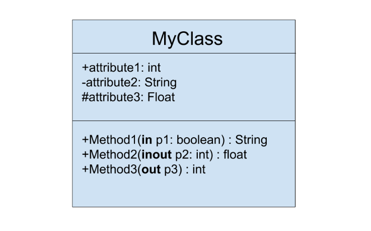

Каждый параметр в методе может также иметь описание направленности метода: in, out, inout.
На этой иллюстрации, method1 использует p1, как входной параметр и значение p1, каким-то образом, используется методом, а метод не изменяет p1.

Method2 принимает p2, как параметр ввода/вывода, значение p2, каким-то образом, используется методом и принимает выходное значение метода, но сам метод также может изменять p2.

Method3 использует p3, как выходной параметр, иными словами, параметр служит хранилищем для выходного значение метода.

Перспективы диаграммы классов в жизненном цикле разработки программного обеспечения
Мы можем использовать диаграммы классов на разных этапах жизненного цикла разработки программного обеспечения и, как правило, постепенно моделируя диаграммы классов с трех разных точек зрения по мере нашего продвижения по уровням детализации.

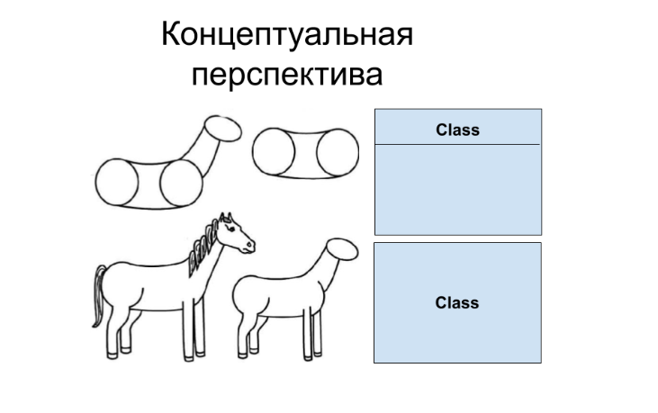

**Концептуальная перспектива** — это когда диаграммы интерпретируются как описание вещей в реальном мире. Таким образом, если мы берем концептуальную перспективу, мы рисуем диаграмму, которая представляет концепции в изучаемой области. Эти концепции относятся к классам, которые их реализуют. Концептуальная перспектива считается независимой от языка.

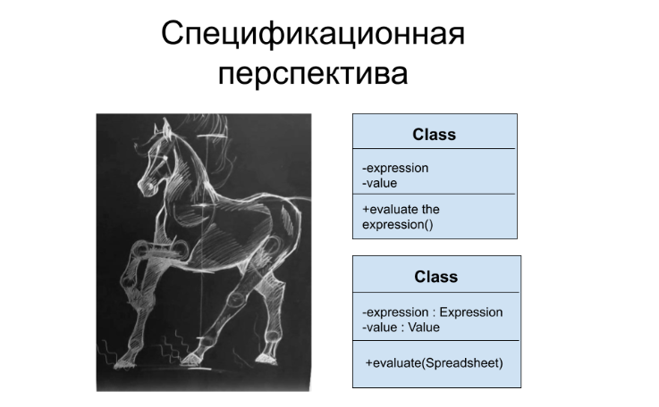

**Спецификационная перспектива** — это когда диаграммы интерпретируются, как описание абстракций программного обеспечения или компонентов со спецификациями и интерфейсами, но без привязки к конкретной реализации.

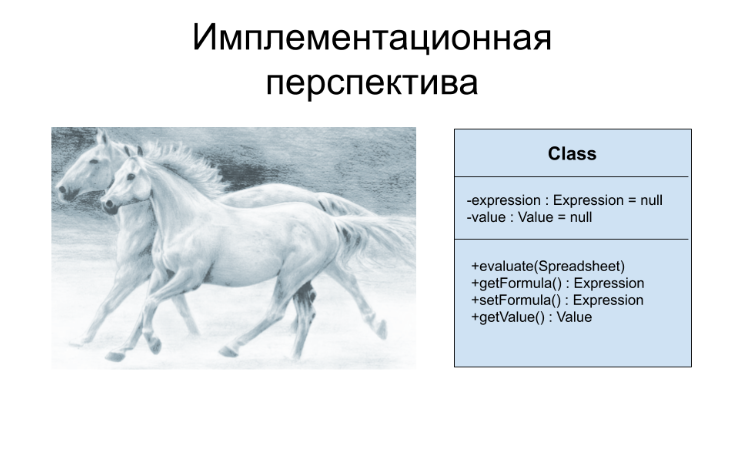

**Имплементационная перспектива** — это когда диаграммы интерпретируются, как описание реализаций программного обеспечения на определенной технологии и языке.  
Таким образом, если ты берешь имплементационную перспективу, ты смотришь на реализацию программного обеспечения.

#### Типы отношений
  
Далее, я приведу шесть основных типов обозначений отношений между классами, которые встречаются в UML схемах чаще всего.  
  
**Ассоциация.**

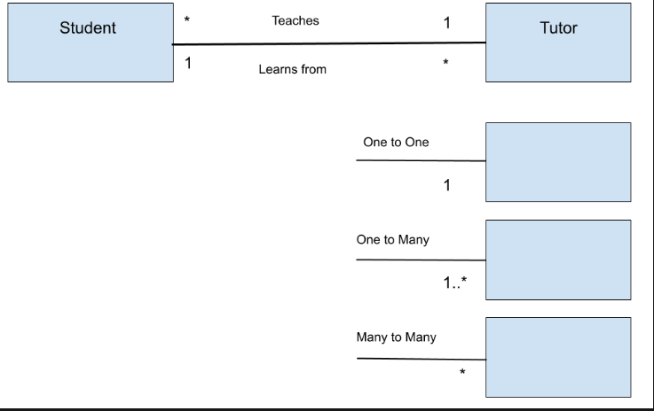

Аналогично связям, соединяющим объекты, ассоциации соединяют классы. Для того, чтобы между объектами была связь, между ними должна быть ассоциация.

Если предположить, что у нас есть два класса, которые взаимодействуют друг с другом, между ними должна быть проведена непрерывная соединительная линия, обозначающая на схеме ассоциацию. Часто мы также можем увидеть глагол, передающий ее смысл.

Помимо этого, мы также можем указать кратность, то есть число объектов, которые могут принимать участие в отношениях. Кратность задается в виде разделенного запятыми списка интервалов, в котором каждый интервал представлен в виде минимум-максимум.

Например, один студент может учиться у множества преподавателей.
Но и преподаватель может учить множество студентов.

**Наследование**

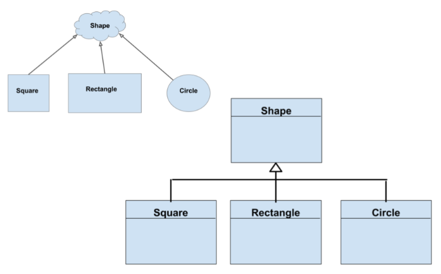

Или иногда его еще называют — генерализация.

Как следует из названия, это схематическое изображение отношения между родительским классом и его наследниками. Полая стрелка всегда направлена к классу «родитель».
Классический пример наследования: классы квадрат, прямоугольник и круг, которые являются наследниками родительского класса «фигура».

Мы вправе изображать наследование как отдельно для каждого класса, так и объединять их.
Если наследование происходит от абстрактного класса, то имя такого родительского класса записывается курсивом.

**Реализация**

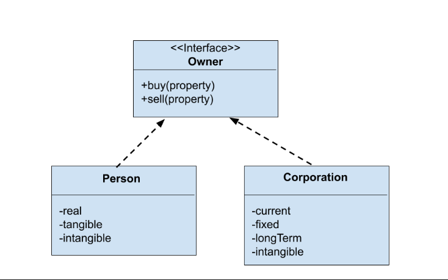

Обычно, под этим подразумевается отношение интерфейса и объектов, реализующих этот интерфейс.  
  
Например, интерфейс Owner имеет методы для покупки и продажи частной собственности, а отношения классов Person и Corporation, реализующих этот интерфейс, на диаграмме будут обозначаться в виде пунктирной линии со стрелкой по направлению к интерфейсу.  
  
**Зависимость**

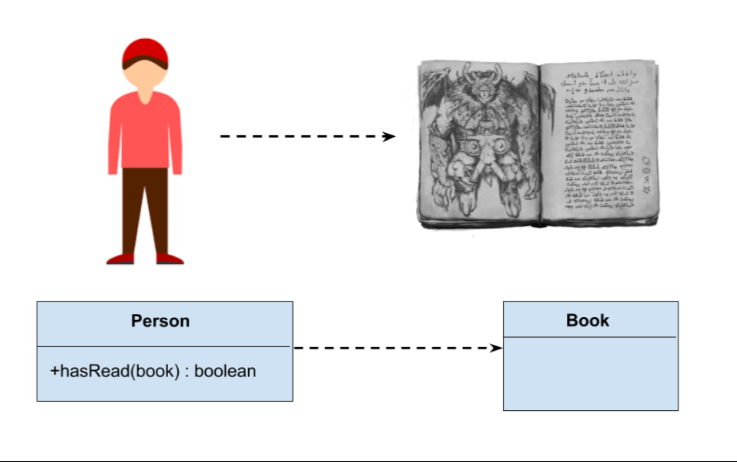

Объект одного класса может использовать объект другого класса в своем методе.  
Если объект не хранится в поле класса, то такой вид межклассовых отношений моделируется как зависимость.  
  
Зависимость, по сути, является специальным случаем ассоциации двух классов, в этом случае, изменения в одном классе неумолимо повлекут за собой изменения в другом.  
  
Например, у класса Person есть метод hasRead с входным параметром book, который возвращает true, если, к примеру, человек прочитал книгу.  
  
Зависимость обозначается пунктирной линией со стрелкой, обращенной к классу, от которого зависят, например, методы другого класса.  
  
**Агрегация**

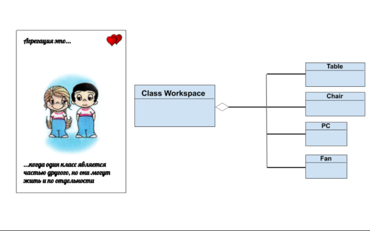

Особый тип отношений между классами, когда один класс является частью другого.

Например, рабочее место программиста состоит из стула, стола, компьютера и вентилятора, но при удалении класса «рабочее место», у нас просто останутся все эти классы, только по отдельности.

Агрегация показана в виде непрерывной линии с полым ромбом направленным от классов, являющимися частью какого-либо класса к классу-агрегатору.

**Композиция**

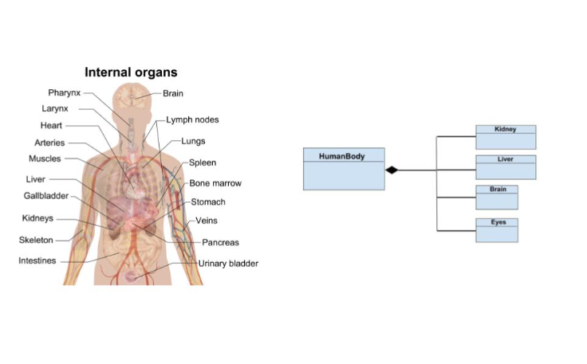

По сути, разновидность агрегации, только в этом случае, классы, являющиеся частью другого класса, уничтожают, когда уничтожается класс-агрегатор.  
  
Например наше тело состоит из органов, но сами по себе они не жизнеспособны.  
  
Композиция обозначается схожим с агрегацией способом, но ромб на этот раз полностью закрашен.